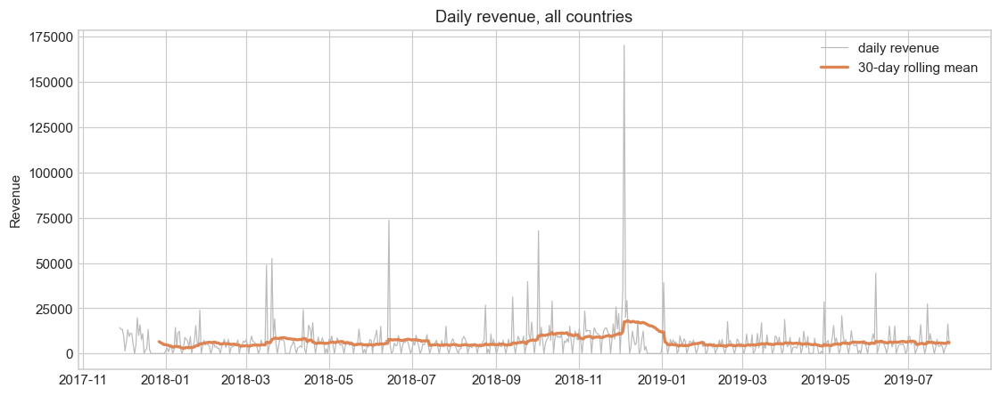
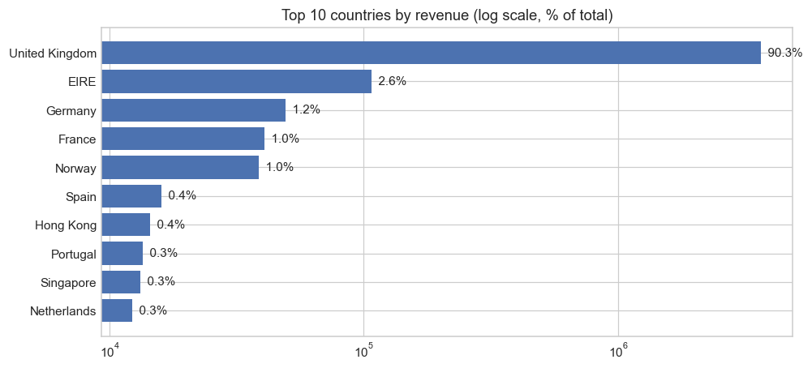
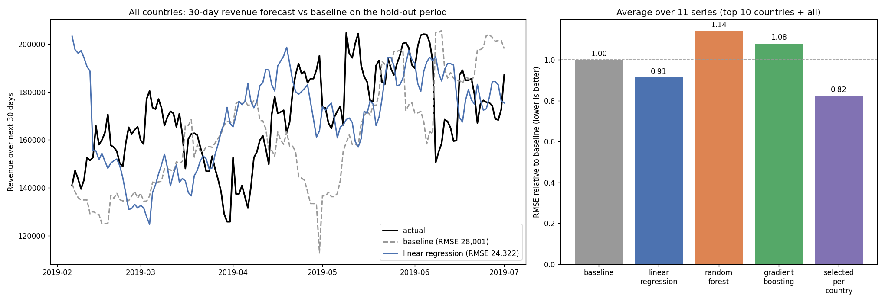
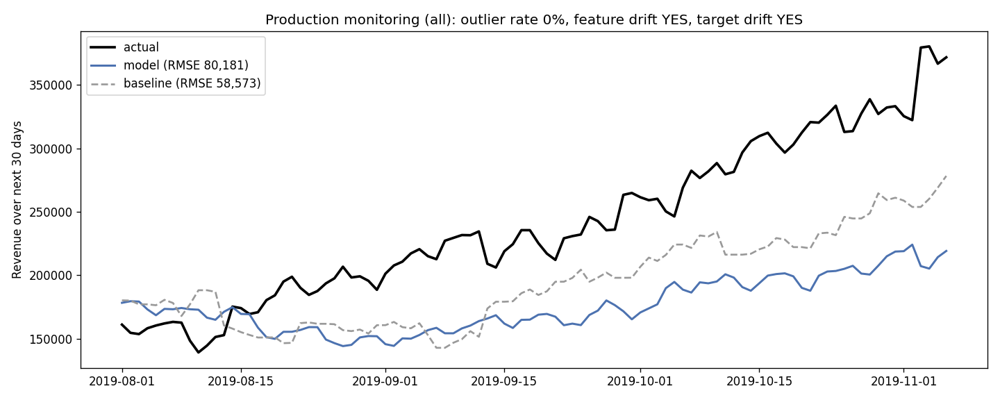

# AAVAIL Revenue Forecasting – IBM AI Workflow Capstone

Forecasting the next 30 days of revenue for AAVAIL, overall and per country, with models served through a Flask API, monitored for drift, covered by unit tests and packaged in Docker.

---

## 1. Business opportunity

AAVAIL management wants to predict revenue for the following month at any point in time, so managers can plan staffing and budgets. They want predictions both for the top ten countries by revenue and for all countries combined.

**Data science framing:** a supervised regression / time-series forecasting problem. For every day, the target is the revenue summed over the next 30 days (that day included).

**Testable hypotheses:**
- **H1:** A model using recent revenue, invoices and views beats a naive baseline that assumes the next 30 days look like the previous 28 days. *Result: supported – per-country model selection lowers the average hold-out RMSE by 16% (5,987 vs 7,111).*
- **H2:** No single model type is best for every country. *Result: supported – linear regression wins for 7 series, random forest for 3 and gradient boosting for 1.*

---

## 2. Repository structure

```
├── data/
│   ├── cs-train/          # training JSON files
│   └── cs-production/     # production JSON files (used for monitoring)
├── ingestion.py           # loads JSON files, builds daily time series and features
├── EDA.ipynb              # exploratory data analysis with visualizations
├── model.py               # compare / train / load / predict
├── logger.py              # train and predict logging
├── monitoring.py          # performance and drift monitoring
├── app.py                 # Flask API
├── unittests/
│   ├── ApiTests.py
│   ├── ModelTests.py
│   ├── LoggerTests.py
│   └── MonitoringTests.py
├── run-tests.py           # runs the full test suite
├── images/                # charts used in this README
├── reports/               # model comparison table and monitoring reports
├── Dockerfile
├── requirements.txt       # runtime dependencies (pinned)
├── requirements-dev.txt   # + jupyter for the EDA notebook
└── README.md
```

`models/` and `logs/` are created at runtime and are not committed.

---

## 3. Setup

```bash
git clone https://github.com/Sanjaycodes019/aavail-revenue-forecasting.git
cd aavail-revenue-forecasting
python -m venv venv
source venv/bin/activate        # Windows: venv\Scripts\activate
pip install -r requirements-dev.txt

python ingestion.py                     # build the training time series
python ingestion.py data/cs-production  # build the production time series
python model.py                         # train the production models
python app.py                           # start the API on port 8080
```

---

## 4. Data ingestion

`ingestion.py` automates loading and preparing the data (`fetch_data`, `convert_to_ts`, `fetch_ts`, `engineer_features`):

- Reads every JSON file in a data directory and makes column names consistent across files (`StreamID`/`stream_id`, `TimesViewed`/`times_viewed`, `total_price`/`price`).
- Combines `year`, `month` and `day` into a single date and keeps only the numeric part of invoice ids (some carry a letter prefix).
- Removes 3 lines with negative prices (accounting adjustments of up to −53,594).
- Adds up the data per day and per country into `purchases`, `unique_invoices`, `unique_streams`, `total_views`, `revenue`. Every country uses the full calendar, with zeros on days without invoices.
- Writes one time-series CSV per country (top 10 by revenue) plus `all` to `<data_dir>/ts-data/`, which is used as a cache.

```bash
python ingestion.py
```

---

## 5. Exploratory data analysis

See [`EDA.ipynb`](EDA.ipynb). Key findings:

- **815,008 invoice lines** from 43 countries, 2017-11-28 to 2019-07-31 (**611 days**).
- **The United Kingdom brings in about 90% of revenue**, and the top 10 countries 97.8%. The "all countries" series is therefore mostly the UK series.
- **Strong holiday peak from September to December 2018**, a dip in February, and a weekly pattern with almost no revenue on Saturdays. Forecasting a 30-day total smooths out the weekly noise.
- **Revenue is strongly correlated with purchases, invoices, streams and views**, so recent activity is a useful predictor.





---

## 6. Modeling

### Features
For each day, using only data from **before** that day:
- `previous_7`, `previous_14`, `previous_28`, `previous_70`: revenue summed over the previous N days
- `recent_invoices`, `recent_views`: mean daily invoices and views over the previous 30 days

A "same 30 days last year" feature was tried and dropped. With only about 20 months of data, it is zero for the whole first year and non-zero only from the November 2018 peak onward, so models learned it as a false "peak season" flag. With it, linear regression's hold-out RMSE for all countries was 85,624 instead of 24,322.

### Models compared

Evaluation: time-ordered split, with the most recent 25% of days as the hold-out set. Hyperparameters were tuned with `GridSearchCV` and `TimeSeriesSplit`. Errors are averaged over the 11 series (top 10 countries + all); full table in [`reports/model_comparison.csv`](reports/model_comparison.csv).

| Model | Mean RMSE | Mean MAE | RMSE, all countries |
|---|---|---|---|
| Baseline: next 30 days = previous 28 days × 30/28 | 7,111 | 5,534 | 28,001 |
| Linear regression | 6,263 | 4,862 | **24,322** |
| Random forest | 11,422 | 8,518 | 52,258 |
| Gradient boosting | 10,515 | 8,081 | 53,206 |
| **Best model selected per country** | **5,987** | **4,387** | 24,322 |

**Chosen approach:** `model_train()` evaluates all three models for each country and keeps the one with the lowest hold-out RMSE, then refits it on all the data.
- Linear regression is selected for `all`, the UK, Eire, France, Germany, the Netherlands and Spain.
- Random forest is selected for Hong Kong, Portugal and Singapore.
- Gradient boosting is selected for Norway.

The tree models do worst on the large series because they cannot extrapolate beyond the Q4 2018 peak they were trained on.

### Comparison with the baseline



```bash
python model.py compare   # rebuilds reports/model_comparison.csv and images/model_vs_baseline.png
python model.py           # trains the production models
```

---

## 7. API

Start the server:

```bash
python app.py
```

| Endpoint | Method | Description |
|---|---|---|
| `/` | GET | Service information |
| `/train` | POST | Retrains the models (`{"mode": "test"}` trains test models only) |
| `/predict` | POST | Returns the revenue forecast for the 30 days starting at the given date |
| `/logs/<filename>` | GET | Downloads a log file, e.g. `predict-2026-10.log` |

Prediction for one country:

```bash
curl -X POST http://localhost:8080/predict \
  -H "Content-Type: application/json" \
  -d '{"country": "united_kingdom", "year": "2018", "month": "01", "day": "05"}'
```

Prediction for all countries combined:

```bash
curl -X POST http://localhost:8080/predict \
  -H "Content-Type: application/json" \
  -d '{"country": "all", "year": "2018", "month": "01", "day": "05"}'
```

Response:

```json
{"country": "all", "target_date": "2018-01-05", "y_pred": [145238.18], "horizon_days": 30, "model_version": 0.1}
```

- **Countries:** `all`, `united_kingdom`, `eire`, `germany`, `france`, `norway`, `spain`, `hong_kong`, `portugal`, `singapore`, `netherlands`.
- **Request formats:** the body can also be nested as `{"query": {...}}`.
- **Errors:** invalid input (unknown country, missing field, date outside 2017-11-28 to 2019-07-31) returns HTTP 400 with an `error` message.

---

## 8. Logging

`logger.py` writes one CSV line per training run and per prediction:

- **Train log** (`logs/train-YYYY-MM.log`): unique ID, timestamp, country, date range of the training data, hold-out RMSE, runtime, model version, version note with the selected model.
- **Predict log** (`logs/predict-YYYY-MM.log`): unique ID, timestamp, country, target date, prediction, runtime, model version.

Test runs write to `logs/test-train.log` and `logs/test-predict.log`, so production logs are never touched.

---

## 9. Monitoring

`monitoring.py` checks production data (`data/cs-production`, Aug–Dec 2019) against the training data:

- **Input drift:**
  - An `IsolationForest` fit on the training features reports the share of production days that look like outliers.
  - The Wasserstein distance between training and production features (scaled) and targets is compared with a threshold. The threshold is the 95th percentile of distances between bootstrap resamples of the training data and the training data itself.
- **Performance:** every production day with a complete 30-day target is predicted and compared with actual revenue, as RMSE/MAE overall and per month, for both the model and the baseline. The production days are appended to the training series so the look-back features have their full history.

```bash
python monitoring.py            # all countries; or e.g. python monitoring.py united_kingdom
```

**Result for all countries:**

| Check | Result |
|---|---|
| Outlier rate | 0% |
| Feature drift (Wasserstein) | 0.46 vs threshold 0.18: **drift** |
| Target drift (Wasserstein) | 54,716 vs threshold 18,281: **drift** |
| Model RMSE (baseline RMSE) | 80,181 (58,573) |

**What the monitoring shows:**
- **Error grows over time:** model error rises each month (August 31k → November 146k) as the Q4 2019 holiday peak arrives.
- **The cause is known:** the training data contains only one holiday season, so seasonality is not learned.
- **Action:** the drift flags tell AAVAIL to retrain with the new data (`POST /train`). With a second year of history, a seasonal feature becomes usable.



---

## 10. Unit tests

Run the full suite with one command (no server needs to be running; API tests use Flask's test client):

```bash
python run-tests.py
```

| Test file | Covers |
|---|---|
| `unittests/ApiTests.py` | `/`, `/train`, `/predict` (single country, `all`, nested query, bad requests), `/logs` |
| `unittests/ModelTests.py` | training, loading, predicting (`all` and a country), invalid countries and dates |
| `unittests/LoggerTests.py` | train and predict log creation and contents, separate test log files |
| `unittests/MonitoringTests.py` | drift detection flags shifted data and accepts similar data |

**Test isolation:**
- **Test mode:** all tests run in test mode, so models are saved as `models/test-*.joblib` and logs as `logs/test-*.log`.
- **Proof:** each test class takes a snapshot of every production model and log file before it runs and asserts that none were modified afterwards (`test_*_production_untouched`).

```
Ran 21 tests in 22.6s

OK
```

---

## 11. Docker

Build and run:

```bash
docker build -t aavail-revenue-forecasting .
docker run -p 8080:8080 aavail-revenue-forecasting
```

The image build ingests the data, trains the production models and runs the full test suite, so a broken build fails early. The API is then available at `http://localhost:8080`.

---

## 12. Peer review checklist

| Review question | Where to find it |
|---|---|
| Unit tests for the API | `unittests/ApiTests.py` |
| Unit tests for the model | `unittests/ModelTests.py` |
| Unit tests for the logging | `unittests/LoggerTests.py` |
| All tests run with a single script and pass | `run-tests.py` ([section 10](#10-unit-tests)) |
| Mechanism to monitor performance | `monitoring.py` ([section 9](#9-monitoring)) |
| Read/write tests kept away from production | test mode + production snapshot checks ([section 10](#10-unit-tests)) |
| API works for one country and for all countries | [section 7](#7-api), `ApiTests.test_03` / `test_04` |
| Data ingestion is a function or script | `ingestion.py` ([section 4](#4-data-ingestion)) |
| Multiple models compared | [section 6](#6-modeling) |
| EDA uses visualizations | `EDA.ipynb` ([section 5](#5-exploratory-data-analysis)) |
| Everything containerized in a working Docker image | `Dockerfile` ([section 11](#11-docker)) |
| Visualization comparing the model to the baseline | `images/model_vs_baseline.png` ([section 6](#6-modeling)) |
